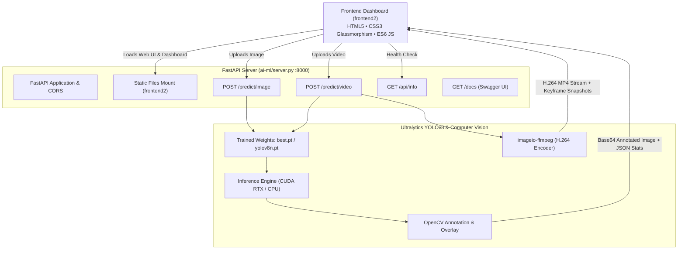

# 🛡️ Port-Guard AI Vision

> **Intelligent Real-Time PPE Compliance & Hazard Detection System for Maritime Ports and Industrial Facilities**

[](https://www.python.org/)
[](https://fastapi.tiangolo.com/)
[](https://github.com/ultralytics/ultralytics)
[](https://opencv.org/)
[](https://developer.nvidia.com/cuda-zone)
[](file:///e:/Port-Guard/frontend2)

---

## 📌 Table of Contents

- [Overview](#-overview)
- [Key Features](#-key-features)
- [Target Classes & Color Mapping](#-target-classes--color-mapping)
- [System Architecture](#-system-architecture)
- [Project Directory Structure](#-project-directory-structure)
- [Prerequisites](#-prerequisites)
- [Quick Start Guide](#-quick-start-guide)
  - [1. Clone and Install Dependencies](#1-clone-and-install-dependencies)
  - [2. Start the Backend & Web Application](#2-start-the-backend--web-application)
  - [3. Alternative Frontend Launch](#3-alternative-frontend-launch)
- [UI Walkthrough & Dashboard Tour](#-ui-walkthrough--dashboard-tour)
- [API Reference](#-api-reference)
- [Model Training Pipeline](#-model-training-pipeline)
- [Troubleshooting & FAQs](#-troubleshooting--faqs)
- [License & Acknowledgments](#-license--acknowledgments)

---

## 🌐 Overview

**Port-Guard** is an industrial-grade computer vision safety platform designed to safeguard maritime docks, container shipping terminals, and cargo handling zones. By deploying a custom fine-tuned **YOLOv8** model, Port-Guard provides real-time multi-hazard detection and PPE compliance verification to mitigate workplace accidents and prevent fire outbreaks before they escalate.

### The Problem It Solves
- **Strict PPE Compliance:** Container yards and port terminals present risks of falling cargo, heavy machinery collisions, and hazardous operations. Port-Guard ensures workers are wearing required hardhats and high-visibility safety jackets.
- **Early Hazard Alerting:** Catastrophic dock fires frequently begin with small smoldering spots or smoke plumes. Port-Guard flags smoke and open fire instantly to trigger rapid suppression.
- **Automated Logging:** Eliminates manual spot-checking with structured detection summaries, bounding coordinates, confidence metrics, and keyframe snapshots.

---

## ✨ Key Features

- **🚀 Real-Time Photo Inspection:** Instant inference on single and high-resolution images with toggleable views (Annotated vs. Original).
- **🎥 High-Performance Video Analysis:** Frame-by-frame processing encoded into web-native H.264 MP4 videos with synchronized bounding boxes.
- **📸 Keyframe Highlight Snapshots:** Automatically captures and presents high-confidence hazard moments from analyzed video streams.
- **📊 Real-Time KPI Metric Cards:** Live visual counters for each detected safety category (Helmets, Safety Jackets, Fire Alerts, Smoke Alerts, and Persons).
- **📋 Detailed Detection Logs:** Tabular telemetry recording object indices, classification labels, confidence percentages, and coordinates `[x1, y1, x2, y2]`.
- **⚡ Hardware Accelerated:** Optimized for NVIDIA CUDA execution (e.g. RTX 2050) with graceful CPU fallback.
- **🔌 Unified Web Stack:** Built-in FastAPI static mount serving both the REST API and the frontend client seamlessly from a single command.

---

## 🎯 Target Classes & Color Mapping

The vision model is trained to classify 5 mission-critical port safety categories:

| ID | Class Label | Type | UI / Bounding Box Color | Purpose |
|:--:|:------------|:-----|:------------------------|:--------|
| `0` | **Person** | Worker | 🔵 Deep Orange / Sky Blue | Tracking human presence in port working zones |
| `1` | **Helmet** | PPE | 🟡 Bright Yellow (`#FFD700`) | Ensuring head safety protocol compliance |
| `2` | **Safety Jacket** | PPE | 🟢 Spring Green (`#00FF7F`) | Ensuring high-visibility gear in traffic lanes |
| `3` | **Fire** | Hazard | 🔴 Crimson Red (`#FF4500`) | Immediate fire danger identification |
| `4` | **Smoke** | Hazard | ⚪ Ash Gray (`#A9A9A9`) | Early fire / smoke smolder warning |

---

## 🏗️ System Architecture



---

## 📁 Project Directory Structure

```plaintext
Port-Guard/
│
├── ai-ml/                             # Machine learning pipeline, weights & backend API
│   ├── datasets/                      # Raw and supplemental training datasets
│   ├── merged_dataset/                # Combined YOLO format dataset
│   │   ├── train/                     # Training images & labels
│   │   ├── valid/                     # Validation split
│   │   ├── test/                      # Testing split
│   │   └── data.yaml                  # Class configuration & relative dataset paths
│   │
│   ├── models/
│   │   ├── pretrained/                # Base weights auto-cached (yolov8n.pt)
│   │   └── trained/                   # Fine-tuned model checkpoints
│   │       └── custom_yolov8_run/
│   │           └── weights/
│   │               ├── best.pt        # Recommended custom-trained model weights
│   │               └── last.pt        # Final epoch weights
│   │
│   ├── src/
│   │   ├── config.py                  # Training configuration (Epochs, Batch size, Paths)
│   │   └── trainer.py                 # Ultralytics training pipeline logic
│   │
│   ├── temp_outputs/                  # Temporary generated annotated MP4 video files
│   ├── main.py                        # Entry point to trigger model training
│   ├── server.py                      # FastAPI web server & prediction endpoints
│   ├── requirements.txt               # Python package dependencies
│   └── README.md                      # AI/ML-specific notes & documentation
│
├── frontend2/                         # Modern web UI client
│   ├── index.html                     # Main dashboard page layout
│   ├── style.css                      # Premium dark-mode glassmorphic design system
│   └── app.js                         # Dynamic DOM interaction, API fetch, & visualizer
│
└── README.md                          # Master project documentation (this file)
```

---

## ⚙️ Prerequisites

1. **Operating System:** Windows 10/11, macOS, or Linux.
2. **Python:** Version `3.10` through `3.14` installed.
3. **NVIDIA GPU (Optional but Recommended):** 
   - NVIDIA GPU (such as RTX 2050, 3060, 4060, etc.) with CUDA support for sub-second image inference and fast video processing.
   - If no GPU is available, the backend automatically switches to CPU mode seamlessly.
4. **Web Browser:** Any modern browser (Google Chrome, Edge, Firefox, or Safari).

---

## 🚀 Quick Start Guide

### 1. Clone and Install Dependencies

Open PowerShell, Command Prompt, or Terminal:

```bash
# 1. Clone repository (if not already done)
git clone https://github.com/pritjasani08/Port-Guard.git
cd Port-Guard

# 2. (Optional) Create and activate a Python virtual environment
py -m venv venv
# On Windows PowerShell:
.\venv\Scripts\Activate.ps1
# On Linux/macOS:
source venv/bin/activate

# 3. Install required dependencies
pip install -r ai-ml/requirements.txt
```

> **Note for Windows Users:** If `python` opens the Microsoft Store, use `py` instead (e.g. `py -m pip install -r ai-ml/requirements.txt`).

---

### 2. Start the Backend & Web Application

Navigate to the `ai-ml` directory and launch the server:

```bash
cd ai-ml
python server.py
# Or using py launcher:
py server.py
```

*Alternatively, you can run via Uvicorn CLI:*
```bash
uvicorn server:app --host 0.0.0.0 --port 8000 --reload
```

When started, the terminal will display:
```plaintext
Loading trained model from: .../models/trained/custom_yolov8_run/weights/best.pt
Model loaded successfully on device: 0 (Classes: {0: 'person', 1: 'helmet', 2: 'safety_jacket', 3: 'fire', 4: 'smoke'})
INFO:     Uvicorn running on http://0.0.0.0:8000 (Press CTRL+C to quit)
```

#### Access Links:
- 🖥️ **Web Dashboard UI:** [http://localhost:8000](http://localhost:8000)
- 📑 **Interactive Swagger API Documentation:** [http://localhost:8000/docs](http://localhost:8000/docs)
- 🩺 **Health & Model Info:** [http://localhost:8000/api/info](http://localhost:8000/api/info)

---

### 3. Alternative Frontend Launch

If you prefer editing the frontend in real time with tools like **VS Code Live Server** (running on port `5500`):
1. Keep the backend running on `http://127.0.0.1:8000`.
2. Right click [frontend2/index.html](file:///e:/Port-Guard/frontend2/index.html) in VS Code and select **Open with Live Server**.
3. `app.js` automatically detects foreign origins and directs all detection requests to `http://127.0.0.1:8000`.

---

## 🎨 UI Walkthrough & Dashboard Tour

The user interface in [frontend2/](file:///e:/Port-Guard/frontend2) provides a streamlined workflow:

```plaintext
+-----------------------------------------------------------------------------------+
|  🛡️ Port-Guard AI Vision             [🟢 Online • NVIDIA GPU (CUDA)]  [📑 Swagger] |
+-----------------------------------------------------------------------------------+
|  [ Photo Inspection ]   [ Video Analysis ]                                        |
|  +-----------------------------------------------------------------------------+  |
|  |                          Drag & Drop Media Here                             |  |
|  |                     or [Browse Files] from computer                         |  |
|  +-----------------------------------------------------------------------------+  |
|                                [ ▶ Run AI Detection ]                             |
+-----------------------------------------------------------------------------------+
|  Detection Results              Inference: 42.1 ms  |  Total Objects: 6            |
|  +---------------+  +---------------+  +------------+  +-----------+  +--------+  |
|  |  🪖 Helmet: 2  |  |  🦺 Jacket: 2  |  |  🔥 Fire: 0|  | 💨 Smoke: 0|  | 👤 PPE: 2 |  |
|  +---------------+  +---------------+  +------------+  +-----------+  +--------+  |
|                                                                                   |
|  [ AI Annotated | Original ]                     [ 📸 Keyframe Snapshots ]         |
|  +----------------------------------------+     +-------------------------------+ |
|  |                                        |     | [Frame 24] [Frame 68]         | |
|  |       Annotated Media Visualizer       |     | [Frame 110]                   | |
|  |                                        |     +-------------------------------+ |
|  +----------------------------------------+                                       |
|                                                                                   |
|  Detection Log:                                                                   |
|  #   Class          Confidence   Bounding Box                                     |
|  1   helmet         94%          [142.0, 56.4, 210.8, 118.2]                      |
|  2   safety_jacket  89%          [130.5, 120.0, 245.2, 310.1]                     |
|  3   person         92%          [115.0, 48.0, 260.0, 520.4]                      |
+-----------------------------------------------------------------------------------+
```

### Highlights:
1. **Header & Status Heartbeat:** Displays real-time connection status with the backend engine, indicating whether CUDA GPU or CPU is active.
2. **Mode Switcher:**
   - **Photo Inspection:** Upload `.jpg`, `.png`, `.webp` images for millisecond analysis.
   - **Video Analysis:** Upload `.mp4`, `.mov`, `.avi` clips to process motion streams and view generated highlight snapshots.
3. **Interactive Media Visualizer:** Tabbed switches allow quick toggling between original raw footage and AI-annotated frames.
4. **Summary KPI Counter Cards:** Instant visibility into detected PPE gear and active hazards.
5. **Detection Log Table:** Complete list of identified objects, confidence probabilities, and spatial bounding boxes.
6. **Export Feature:** Single-click download of annotated imagery.

---

## 📡 API Reference

The FastAPI backend exposes the following endpoints:

### `GET /api/info`
Checks backend status and model metadata.
- **Response:**
  ```json
  {
    "status": "online",
    "model_file": "best.pt",
    "classes": {
      "0": "person",
      "1": "helmet",
      "2": "safety_jacket",
      "3": "fire",
      "4": "smoke"
    },
    "device": "NVIDIA GPU (CUDA)",
    "gpu_name": "NVIDIA GeForce RTX 2050"
  }
  ```

### `POST /predict/image`
Uploads an image for object detection.
- **Form Data:**
  - `file`: Image file (`multipart/form-data`)
  - `conf`: Confidence threshold (default: `0.25`)
  - `iou`: IoU threshold for NMS (default: `0.45`)
- **Response:**
  - `total_detections`: Integer count of detected objects
  - `counts`: Dictionary breakdown per class
  - `detections`: Array of objects with bounding boxes `[x1, y1, x2, y2]` and confidence
  - `inference_time_ms`: Processing time in milliseconds
  - `annotated_image`: Base64 JPEG data URI for instant rendering

### `POST /predict/video`
Processes an uploaded video file.
- **Form Data:**
  - `file`: Video file (`mp4`, `avi`, etc.)
  - `conf`: Confidence threshold (default: `0.25`)
- **Response:**
  - `processed_frames`: Total frames analyzed
  - `video_url`: Endpoint URL for downloading/streaming the processed MP4
  - `snapshots`: Base64-encoded keyframe snapshots of significant detections

### `GET /api/video/{filename}`
Streams or downloads a processed video file encoded with H.264.

---

## 🧠 Model Training Pipeline

To retrain or fine-tune the YOLOv8 model on custom datasets:

1. **Dataset Setup:**
   Ensure annotations and images are placed in `ai-ml/merged_dataset/` following the YOLO layout:
   ```plaintext
   merged_dataset/
   ├── train/ (images & labels)
   ├── valid/ (images & labels)
   ├── test/  (images & labels)
   └── data.yaml
   ```

2. **Hyperparameters:**
   Adjust settings in [ai-ml/src/config.py](file:///e:/Port-Guard/ai-ml/src/config.py):
   ```python
   EPOCHS = 30
   BATCH_SIZE = 8   # Ideal for 4GB VRAM
   IMG_SIZE = 640
   ```

3. **Run Training:**
   ```bash
   cd ai-ml
   python main.py
   ```
   - Automatically downloads the base `yolov8n.pt` architecture.
   - Fine-tunes weights across the dataset.
   - Saves final checkpoints to `ai-ml/models/trained/custom_yolov8_run/weights/best.pt`.

---

## ❓ Troubleshooting & FAQs

### 1. `python` command is not recognized or opens Microsoft Store
- On Windows, use the Python launcher:
  ```powershell
  py server.py
  ```
- Or run using the full path to your Python installation:
  ```powershell
  & "C:\Users\<Username>\AppData\Local\Programs\Python\Python314\python.exe" server.py
  ```

### 2. How to verify if CUDA GPU acceleration is active?
Visit [http://localhost:8000/api/info](http://localhost:8000/api/info) in your browser. Look for:
```json
"device": "NVIDIA GPU (CUDA)"
```
If it says `"CPU"`, PyTorch with CUDA support can be reinstalled using:
```bash
pip install torch torchvision --index-url https://download.pytorch.org/whl/cu121
```

### 3. Port 8000 is already in use
Specify a different port when launching Uvicorn:
```bash
uvicorn server:app --port 8080 --reload
```
*(If you do this, also update `API_BASE` in `frontend2/app.js` if running via Live Server).*

---

## 📄 License & Acknowledgments

- **Model Framework:** [Ultralytics YOLOv8](https://github.com/ultralytics/ultralytics)
- **API Framework:** [FastAPI](https://fastapi.tiangolo.com/)
- **Icons & Visuals:** Feather / Lucide SVGs & Modern Glassmorphic UI

Developed for safety, compliance, and proactive hazard prevention across ports and industrial yards. ⚓🦺🪖🔥
